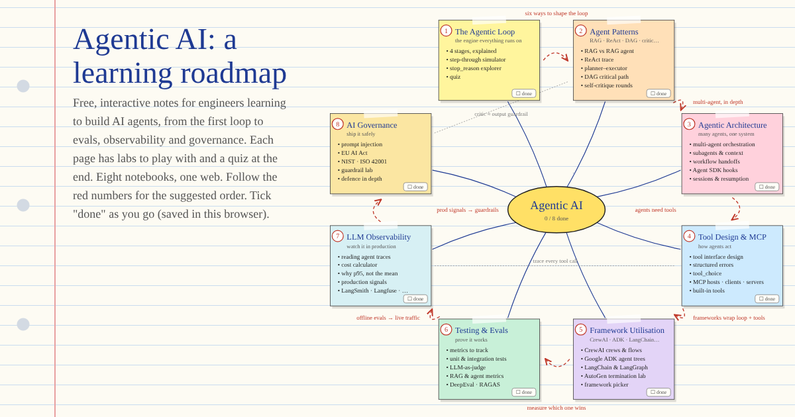

# Agentic AI for beginners

Free, interactive, notebook-style pages for engineers learning to build AI agents.
Each page explains one topic with diagrams, hands-on labs and a quiz at the end.

**Start here:** https://devlcodes.github.io/agentic-ai-beginner/

## Topics

Follow them in order, or jump to whatever you need.

1. [The Agentic Loop](https://devlcodes.github.io/agentic-ai-beginner/agentic-loop.html): perceive, reason, act, observe, with a step-through simulator
2. [Agent Patterns](https://devlcodes.github.io/agentic-ai-beginner/agent-patterns.html): RAG agents, ReAct, planner–executor, DAGs, multi-agent, self-critique
3. [Agentic Architecture](https://devlcodes.github.io/agentic-ai-beginner/agentic-architecture.html): orchestration, subagent context, deterministic gates, hooks, sessions
4. [Tool Design & MCP](https://devlcodes.github.io/agentic-ai-beginner/tool-design-mcp.html): tool descriptions, structured errors, `tool_choice`, MCP servers
5. [Framework Utilisation](https://devlcodes.github.io/agentic-ai-beginner/frameworks.html): CrewAI, Google ADK, LangGraph, LlamaIndex, Semantic Kernel, AutoGen
6. [Testing & Evals](https://devlcodes.github.io/agentic-ai-beginner/testing-and-evals.html): unit and trajectory tests, LLM-as-judge, RAG metrics, DeepEval, RAGAS
7. [LLM Observability](https://devlcodes.github.io/agentic-ai-beginner/llm-observability.html): OpenTelemetry traces, cost and latency, production signals
8. [AI Governance](https://devlcodes.github.io/agentic-ai-beginner/ai-governance.html): prompt injection, OWASP LLM Top 10, EU AI Act, NIST, guardrails

Then the retrieval and model track:

9. [Weights in Retrieval](https://devlcodes.github.io/agentic-ai-beginner/retrieval-weights.html): hybrid fusion weights, reciprocal rank fusion, field and recency boosts, tuning on a labelled set
10. [Reranking with Cross-Encoders](https://devlcodes.github.io/agentic-ai-beginner/reranking-cross-encoders.html): bi-encoders vs cross-encoders, retrieve-then-rerank, latency budgets, ColBERT and LLM rerankers
11. [Citations](https://devlcodes.github.io/agentic-ai-beginner/citations.html): citation granularity, native citation APIs, verifying citations in code, citation precision and recall
12. [Confidence Scoring](https://devlcodes.github.io/agentic-ai-beginner/confidence-scoring.html): confidence signals, calibration, thresholds as a cost decision, abstain and escalate
13. [Open-Weight Models](https://devlcodes.github.io/agentic-ai-beginner/open-weight-models.html): open-weight vs open-source, licences, VRAM math, quantization, self-hosting

Coming next: agent memory, production, and fine-tuning.

## Go deeper

- [Agentic system designs](https://devlcodes.github.io/agentic-ai-notebook/system-design/): end-to-end designs of real agentic systems, in a field-manual style
- [Classic system design](https://github.com/DevLCodes/classic-system-designs): load balancing, caching, sharding, and walkthroughs such as a URL shortener and ride matching

## Contributing

Plain static HTML with no build step, served by GitHub Pages from `main`. Each page inlines its own CSS; read [STYLES.md](STYLES.md) before adding one.
